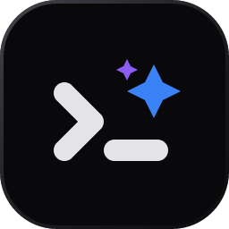
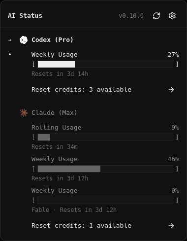
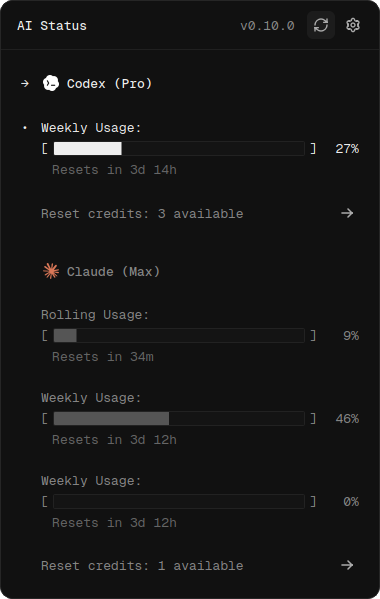
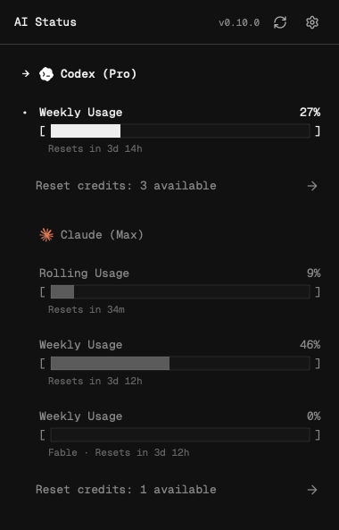
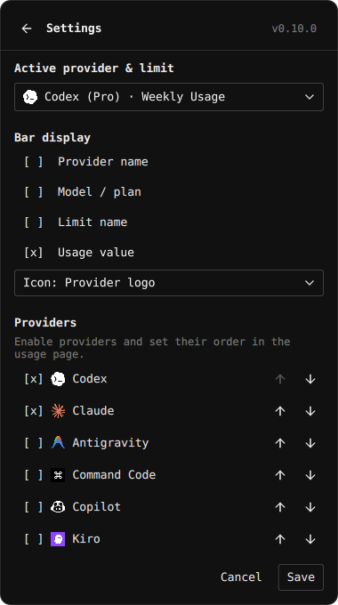
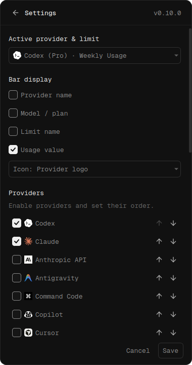
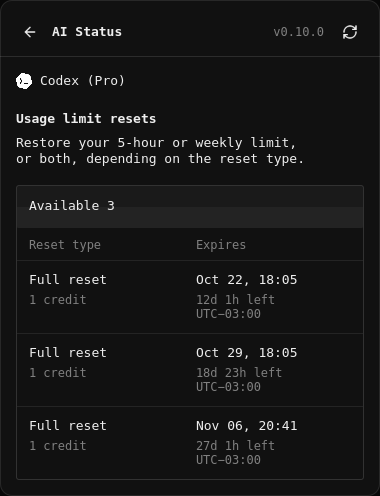
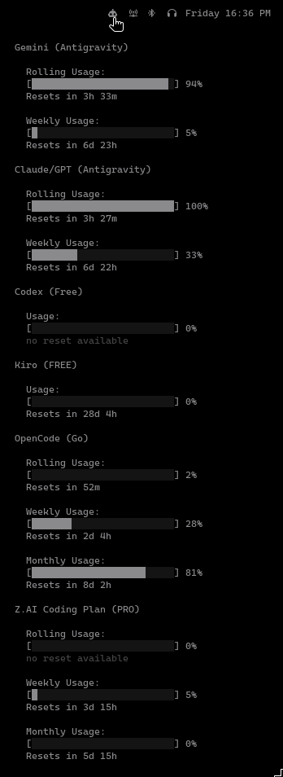

<div align="center">
  
  <h1>AI Status</h1>
  <p><strong>Your AI usage, at a glance.</strong></p>
  <p>Track usage limits, reset timers and available reset credits from your desktop.<br />Native panels for Omarchy Quickshell, Windows and macOS, plus Waybar integration.</p>
  <p>
    <a href="https://github.com/gelzinn/ai-status/releases/latest"></a>
    <a href="https://github.com/gelzinn/ai-status/actions/workflows/release.yml"></a>
    <a href="LICENSE"></a>
  </p>
  <p>
    <a href="https://ai-status.gelzin.com">Website &amp; interactive preview</a> ·
    <a href="#installation-guide">Install</a> ·
    <a href="#platform-support">Platforms</a> ·
    <a href="#command-line">CLI</a> ·
    <a href="#supported-providers">Providers</a> ·
    <a href="#documentation">Documentation</a>
  </p>
</div>

<table>
  <tr>
    <th align="left">Linux · Omarchy Quickshell</th>
    <th align="left">Windows tray</th>
    <th align="left">macOS menu bar</th>
  </tr>
  <tr>
    <td valign="top"></td>
    <td valign="top"></td>
    <td valign="top"></td>
  </tr>
</table>

*Example panels rendered with sample usage data. Omarchy follows your shell theme.*

<a id="quick-start"></a>

## Installation guide

Sign in to the providers you want to monitor using their apps or CLIs, then expand the guide for your system. See [provider authentication](packages/lib/PROVIDERS.md) for credentials and additional setup.

<details>
<summary><strong>Linux — Waybar or Omarchy Quickshell</strong></summary>

### Omarchy Quickshell

On the Omarchy Quattro shell:

```bash
omarchy plugin add https://github.com/gelzinn/ai-status.git --enable
```

The plugin includes its Python backend. Click the widget for usage; right-click or use the settings icon to configure providers, select one or more limits for the bar, and change its appearance. The panel shares your existing AI Status preferences and cache with Waybar.

Update the plugin with:

```bash
omarchy plugin update io.github.gelzinn.ai-status && omarchy restart shell
```

After a successful update, restarting the shell loads the new plugin components.

[Dependencies, placement and configuration →](packages/lib/LINUX.md#omarchy-quickshell-plugin)

### Linux with Waybar

```bash
curl -fsSL https://ai-status.gelzin.com/install | bash -s -- --bar waybar
```

The installer walks you through provider selection and appearance, then configures Waybar. Hover for details, scroll to switch providers, middle-click to switch limits and right-click for configuration.

Run the same command to update to the latest stable release. Existing preferences are preserved, and the installer keeps a backup of your Waybar configuration. The installer also supports Omarchy; omit `--bar waybar` to detect your active bar automatically.

[Installation options →](packages/lib/LINUX.md) · [Updates and rollback →](packages/lib/UPDATES.md)

<details>
<summary>Manual Waybar configuration</summary>

Add the module definition to `~/.config/waybar/config.jsonc`:

```jsonc
"custom/ai-status": {
    "exec": "~/.local/bin/ai-status daemon",
    "restart-interval": 1,
    "return-type": "json",
    "format": "{}",
    "tooltip": true,
    "on-click": "~/.local/bin/ai-status refresh",
    "on-click-right": "~/.local/bin/ai-status config",
    "on-scroll-up": "~/.local/bin/ai-status scroll-up",
    "on-scroll-down": "~/.local/bin/ai-status scroll-down",
    "on-click-middle": "~/.local/bin/ai-status cycle-metric"
}
```

Then reference it in whichever bar section you use — a module that's defined but not listed in a `modules-*` array **won't render**:

```jsonc
{
    // ...
    "modules-right": [
        "custom/ai-status",
        "clock",
        "tray"
    ]
    // ...
}
```

**Want the provider's logo too?** Install with `--icon-mode logo` (or add it by hand — see [LINUX.md](packages/lib/LINUX.md)). It adds an `image#ai-status` module next to the text that shows the first available selected item's provider logo and the same tooltip on hover; all selected usage labels appear in the text. Remember to list `"image#ai-status"` in `modules-right` alongside `"custom/ai-status"`.

</details>

</details>

<details>
<summary><strong>Windows 10/11 x64</strong></summary>

### Windows 10/11

1. Open the [latest release](https://github.com/gelzinn/ai-status/releases/latest).
2. Download `ai-status-<version>-windows-x64-setup.exe` and run it as your normal user, or extract the portable `ai-status-<version>-windows-x64.zip`.
3. Launch **AI Status** from the Start menu, or open `ai-status.exe` in the extracted portable folder. Click a tray logo to see usage. Settings lets you select several limits, with one tray icon and an account/limit/value tooltip for each. Windows controls which icons appear beside the clock or in the hidden-icons menu.

The packaged app includes its runtime. Installation needs no administrator access, Python setup or WSL. Provider apps and authenticated sessions remain separate prerequisites. Enable **Start when I sign in to Windows** in Settings if you want it to launch at sign-in.

[Windows installation, updates and provider compatibility →](packages/lib/WINDOWS.md)

</details>

<details>
<summary><strong>macOS 13+</strong></summary>

### macOS 13+

```bash
curl -fsSL https://ai-status.gelzin.com/install/macos | bash
```

The installer builds a native SwiftUI/AppKit menu bar app with the same usage, Settings, reset-credit and About page structure as Windows and Quickshell. Click the menu bar item to open the panel, use **Settings** to select one or more limits for the menu bar, and use **Refresh** to update usage.

Requires macOS 13+, Python 3.10+ and Xcode Command Line Tools (`xcode-select --install`). The native integration does not require SwiftBar. Re-run to update while keeping your preferences. Existing SwiftBar users can select `--mode stream` or `--mode periodic` instead.

[macOS installation, updates and SwiftBar options →](packages/lib/MACOS.md)

</details>

## Command line

Start with `ai-status --help`; `ai-status --version` prints the installed
version. On Linux, `ai-status` without arguments shows help; on Windows and
macOS it opens the native app. Use `ai-status-cli.exe` for terminal commands
in the Windows package, or `~/.local/bin/ai-status` on Linux/macOS if needed.

### Check usage and open settings

```bash
ai-status help accounts add   # Help for a specific command
ai-status providers          # Provider IDs and enabled default connections
ai-status status             # Collect usage and print JSON
ai-status doctor             # Installation details as JSON
ai-status update             # Start the updater for your installation
ai-status config             # Provider and display settings
ai-status config --usage-display remaining  # Show quota remaining
ai-status config --usage-display used       # Show quota used (default)
```

Choose **Used** or **Remaining** in Settings, the terminal configuration UI,
or the Linux installation wizard. The CLI option saves the same preference
without opening Settings. It applies to quota percentages, progress bars, and
amounts with a known limit; uncapped spend and available balances keep their
original meaning.

Sign in through the provider's own app or CLI. Your normal Codex login supplies
the default Codex connection; it does not need `accounts add`.

### See detected connections

```bash
ai-status accounts             # List connections from the last panel snapshot
ai-status accounts --refresh   # Collect enabled connections, then list
```

Illustrative rows when default Codex is already visible in the panel:

```text
ID             PROVIDER  LABEL    SOURCE   COLLECTION  USAGE
default:codex  codex     Default  default  enabled     available
```

The first command reads local data without checking provider logins. Use
`--refresh` when you want to query the enabled connections before listing.

### Add a separate work profile

Point to an existing credential file from that profile. `--id` is the account
identifier used for edits and removal; `--label` is its display name.

```bash
ai-status accounts add codex --id work-codex --label Work \
  --auth-file /path/to/work-codex/auth.json
ai-status accounts
```

Illustrative rows when the panel has data for default Codex and the saved Work
profile has not been checked:

```text
ID             PROVIDER  LABEL    SOURCE   COLLECTION  USAGE
default:codex  codex     Default  default  enabled     available
work-codex     codex     Work     saved    enabled     not_checked
```

`SOURCE` distinguishes existing default connections from saved accounts.
`COLLECTION` shows whether queries are enabled; `USAGE` describes the last
recorded data. Listing reads the panel's cache and saved accounts without
checking provider logins. Manage `default:codex` through `config`.

### Filter and manage accounts

```bash
ai-status accounts --saved                      # Show only saved accounts
ai-status accounts --saved --json               # Previous saved-account JSON schema
ai-status accounts edit work-codex --label "Work team"
ai-status accounts edit work-codex --disabled
ai-status accounts remove work-codex
```

`accounts list` is equivalent to `accounts`. Add `--json` to get the combined
list as JSON; use `--saved --json` for the previous saved-account format.
`--saved` and `--refresh` cannot be combined. Edit and remove apply to saved
accounts; removing one keeps its external credential file.

For an API account, you can reference an existing environment variable instead:

```bash
ai-status accounts add openrouter --id work-router --label "Work API" \
  --env OPENROUTER_API_KEY=OPENROUTER_WORK_KEY
```

Here `OPENROUTER_WORK_KEY` must contain your key and be available to the AI Status
process. The connection stores the variable reference, not the key value.

[CLI usage and account commands →](packages/lib/LINUX.md#command-line) ·
[Credential sources and multiple accounts →](packages/lib/PROVIDERS.md#multiple-accounts-and-connections)

## What you get

- **29 providers in one view.** Track subscription limits, API costs and prepaid balances, including separate rolling, weekly, monthly and per-model windows.
- **Choose what stays visible.** Settings → Providers has one compact row per connection: **Active**, its name, **Show in bar** and reorder arrows. Active controls usage collection; Show in bar controls visibility. Click the provider name to choose account/limit items in a small menu. Move a row up or down to set the same provider order in Usage and the bar. Linux and macOS show selected usage together; Windows creates a tray icon for each item with its account, limit and value in the tooltip. Windows controls icon visibility and placement in its notification area. Choose display fields and icon style in General.
- **Multiple accounts.** Add as many connections as you need for each provider, with independent labels, credentials, caches and selected metrics. Manage connections with `ai-status accounts`; enable and reorder them in the desktop Settings.
- **Native settings.** One Providers list combines active connections, bar visibility and shared ordering in the Omarchy, Windows and macOS panels. A connection can stay active without appearing in the bar. Limit choices open from its row, keeping the list compact. General contains appearance and automatic refresh; Alerts stays separate. Windows also supports drag and drop; Waybar uses an interactive configuration TUI.
- **Apply available resets.** See reset countdowns and Claude/Codex reset credits, with expiry dates, remaining time and time zones when reported. Choose **Apply** in the native panels to confirm within that row, then hold the confirmation button for **3 seconds** to consume one credit. Releasing early resets the progress. Usage refreshes afterward; uncertain results require checking the account before confirming another reset. [Reset eligibility →](packages/lib/PROVIDERS.md#claude)
- **Claude Cloud credits.** Open the credit details to see reported USD balance, local expiration and availability per account, including expired cached credits while offline. Cloud, API spend and saved quota resets stay separate.
- **Quota alerts and recovery notices.** Receive desktop alerts at 80%, 95% and 100% consumed, customize thresholds per account and window, and silence them temporarily or outside working hours. A fresh check confirms recovery across all observed limits. [Configure notifications →](packages/lib/NOTIFICATIONS.md)
- **Refresh when you need it.** Choose automatic updates from 5 to 60 minutes in 5-minute steps in Settings → General, with 5 minutes as the default. The slider applies when you save, and provider cooldowns remain enforced. Manual refresh and loading feedback remain available. Each refresh also checks for a newer stable release. Usable cached data remains visible when a refresh fails.
- **Optional updates.** The blue update link opens instructions inside the desktop panel. Start an update in a terminal on Linux/macOS, or download and open a verified installer on Windows. Portable installations include manual instructions.
- **A desktop runtime.** The Omarchy widget runs inside the existing shell with one backend across monitors. Windows uses Qt widgets with a bundled runtime. macOS uses SwiftUI/AppKit and the same Python backend. Desktop installation requires no Node or NPM.

<details>
<summary>More views: settings, reset credits and Waybar</summary>

<table>
  <tr>
    <th align="left">Omarchy settings</th>
    <th align="left">Windows settings</th>
  </tr>
  <tr>
    <td valign="top"></td>
    <td valign="top"></td>
  </tr>
</table>



Save applies preferences and keeps Settings open. Back sits before the panel title. **About AI Status** contains the project details, links and a short usage guide.

**Waybar usage tooltip**



</details>

## Platform support

| System | Supported versions / environment | Desktop integration |
| --- | --- | --- |
| **Linux** | Wayland session with Waybar | Status module and detailed usage tooltip |
| **Linux / Omarchy** | Omarchy Quattro shell (Quickshell) | Native bar widget, usage panel and settings |
| **Windows** | Windows 10 version 1809+ or Windows 11, x64 | Native tray app, usage panel and settings |
| **macOS** | macOS 13 or newer | Native menu bar app; optional SwiftBar integration |

Linux integration currently supports **Waybar and Omarchy Quickshell only**. The Quickshell plugin requires the Omarchy Quattro shell and its plugin CLI; standalone Quickshell configurations and other bars are not supported. See [Linux requirements](packages/lib/LINUX.md).

The Windows package includes its runtime. The macOS installer requires Python 3.10+ and Xcode Command Line Tools; see [macOS requirements](packages/lib/MACOS.md#requirements).

## Supported providers

| Provider | Usage tracked | Credentials / source |
| --- | --- | --- |
|  **Claude** | Session (5h) and weekly usage, including per-model weekly limits | Claude Code OAuth (OpenCode fallback) |
|  **Codex** | 5-hour and weekly limits (a single monthly window on free plans) | ~/.codex/auth.json |
|  **OpenCode** | Rolling, weekly, and monthly usage | OpenCode auth + workspace config |
|  **Antigravity** | Weekly and 5-hour limits per model (Gemini and Claude/GPT) | agy CLI session |
|  **Copilot** | Chat and completions usage | OpenCode auth (Copilot) |
|  **Z.AI** | Rolling, weekly, and monthly usage | OpenCode auth (Z.AI) |
|  **Kiro** | Usage percentage and reset timer | kiro-cli session |
|  **Command Code** | 5-hour and weekly spend limits; monthly spend and available credits | ~/.commandcode/auth.json (cmd login) |
|  **Anthropic API** | Monthly organization API spend | ANTHROPIC_ADMIN_KEY (organization Admin key) |
|  **OpenAI API** | Monthly organization API spend | OPENAI_ADMIN_KEY (organization Admin key) |
|  **Google Cloud** | Project quotas; optional billing-export monthly cost | gcloud or GOOGLE_CLOUD_ACCESS_TOKEN; project_id option |
|  **OpenRouter** | Key usage and limits; account spend / total credits and remaining balance | OPENROUTER_API_KEY; optional OPENROUTER_MANAGEMENT_KEY |
|  **DeepSeek** | Available prepaid balance | DEEPSEEK_API_KEY |
|  **DeepInfra** | Prepaid balance and current-month spend | DEEPINFRA_API_KEY |
|  **Kimi** | Coding subscription quota and rolling limits | KIMI_API_KEY or Kimi CLI login |
|  **MiniMax** | Token Plan quota windows | MINIMAX_API_KEY (Token Plan key) |
|  **Kilo** | Personal or organization credit balance | KILO_API_KEY; optional organization_id |
|  **Lyceum** | Available USD balance and reported spend | LYCEUM_API_KEY |
|  **Novita** | Available prepaid balance | NOVITA_API_KEY |
|  **Moonshot** | Available USD or CNY balance | MOONSHOT_API_KEY; region option |
|  **Grok API (xAI)** | Team prepaid balance | XAI_MANAGEMENT_KEY; team_id for organization-scoped keys |
|  **SuperGrok** | Subscription credits and product usage | Grok Build login or SUPERGROK_ACCESS_TOKEN |
|  **Grok Bot** | Weekly included usage | Grok Bot desktop login or GROK_BOT_ACCESS_TOKEN |
|  **Cursor** | Included usage pools and on-demand spend | Cursor IDE/agent login or CURSOR_ACCESS_TOKEN |
|  **Nous Research** | Subscription and top-up credits | NOUS_ACCESS_TOKEN or existing OAuth credentials |
|  **Ollama Cloud** | Cloud session/weekly or monthly quota | OLLAMA_API_KEY (cloud key) |
|  **OrcaRouter** | Credit limit, spend and remaining balance | ORCAROUTER_API_KEY |
|  **Alibaba Model Studio** | Token Plan rolling and weekly quota | bl auth login --console |
|  **Devin** | Daily and weekly CLI quota; optional overage balance | Official Devin CLI credentials |

Available metrics depend on the account, plan and upstream API. Providers without usable data stay available in Settings. See the [authentication guide](packages/lib/PROVIDERS.md) and [Windows compatibility notes](packages/lib/WINDOWS.md#authentication-and-provider-compatibility) for setup details, including Kiro on Windows 10.

## Documentation

| Guide | What you will find |
| --- | --- |
| [Install and configure](packages/lib/INSTALL.md) | Choose the Linux, Windows or macOS setup guide |
| [Linux](https://ai-status.gelzin.com/linux) | Waybar and Omarchy Quickshell requirements, installation and configuration |
| [Windows](packages/lib/WINDOWS.md) | Installer, portable app, sign-in option, updates and provider compatibility |
| [macOS](packages/lib/MACOS.md) | Native menu bar app, installation, updates, sign-in startup and optional SwiftBar modes |
| [Guide for LLMs](https://ai-status.gelzin.com/llms.txt) | Select the Linux, Windows or macOS instructions for your system |
| [Providers and authentication](packages/lib/PROVIDERS.md) | Credential sources, account setup and troubleshooting |
| [Updates and rollback](packages/lib/UPDATES.md) | Stable releases, version selection, checksums and recovery |
| [Changelog](https://ai-status.gelzin.com/changelog) | Changes in each published release |
| [Releases](https://github.com/gelzinn/ai-status/releases) | Linux packages, Windows downloads and release notes |

## How it works

A shared Python backend queries enabled connections with bounded parallel workers at the saved refresh interval, defaulting to five minutes. Each provider has its own collector and parser. Waybar consumes JSON with a Pango tooltip; the Omarchy plugin consumes structured snapshots through a shared QML model. The Windows adapter renders the same provider data in a native Qt tray panel; macOS uses a SwiftUI/AppKit menu bar panel backed by the shared JSON daemon.

Credentials come from your local provider authentication stores or explicitly configured keys. AI Status does not ship credentials, perform provider sign-in or modify provider credential files. Authenticate through the provider's own app or CLI. [Read the security overview →](https://ai-status.gelzin.com/security)

<details>
<summary>Repository layout</summary>

| Path | Purpose |
| --- | --- |
| `package.json` | Canonical product version and npm workspaces |
| `packages/lib/src/bin/ai-status` | CLI entry point |
| `packages/lib/src/core/` | Shared queries, state, output and desktop adapter |
| `packages/lib/src/providers/` | Provider collectors and parsers |
| `packages/lib/quickshell/` | Native Omarchy widget, panels and shared model |
| `packages/lib/windows/` | Windows packaging and installer |
| `packages/lib/macos/` | Native macOS menu bar app and local build |
| `packages/shared/providers/` | Provider names, logos and metadata |
| `apps/web/` | Website, interactive preview and documentation |
| `docs/development/` | Platform build and development validation instructions |
| `manifest.json` | Omarchy plugin contract; version synchronized from `package.json` |

</details>

<details>
<summary>Upgrading from v0.4.x / omarchy-ai-status</summary>

The project is now **AI Status**. The installer migrates existing preferences. Update your Waybar configuration to use `ai-status` instead of `waybar-ai-status`. See the [update guide](packages/lib/UPDATES.md) for the current stable-release flow.

</details>

## Contributing

[Report a bug](https://github.com/gelzinn/ai-status/issues/new?template=bug_report.md), [suggest a feature](https://github.com/gelzinn/ai-status/issues/new?template=feature_request.md) or open a pull request. Provider integrations live in `packages/lib/src/providers/`; see the [provider architecture](packages/lib/PROVIDERS.md#provider-architecture) before adding a collector.

[MIT licensed](LICENSE) · Created by [gelzin.com](https://gelzin.com).
