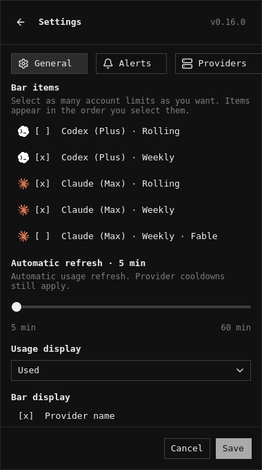
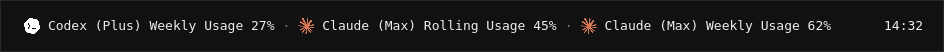
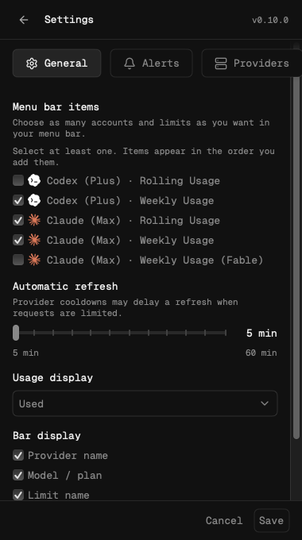
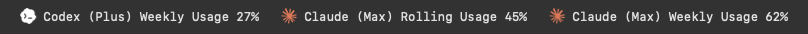
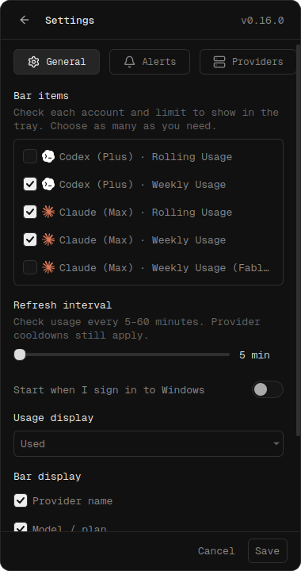
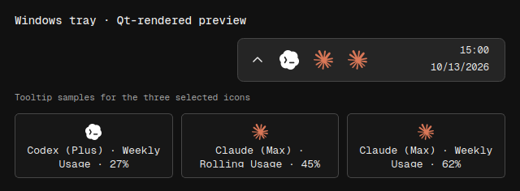

# Multiple bar item previews

Each pair shows the same three selections and their resulting bar or tray:
Codex (Plus) Weekly Usage **27%**, Claude (Max) Rolling Usage **45%**, and
Claude (Max) Weekly Usage **62%**, in that order. Codex Rolling and Claude
Weekly Fable remain unchecked. All usage is synthetic; no provider accounts or
credentials are used.

| Platform | General settings | Bar or notification area |
| --- | --- | --- |
| Linux (Quickshell) |  |  |
| macOS |  |  |
| Windows |  |  |

Linux renders the production `Panel.qml` and `BarWidget.qml` with Qt Quick Test,
the repository's dark theme and host fixtures, and the software renderer. The
nearby clock provides placement context. This is an offscreen preview rather
than a desktop capture; Waybar and SwiftBar use their existing single-image
modules with combined text.

Windows renders the production Qt settings with its Windows startup option.
The notification area is an explicitly labeled Qt preview: its three icons and
tooltip strings come from the production `Dashboard` and `QSystemTrayIcon`
instances. The surrounding tray strip and clock provide placement context,
and the cards show each icon's tooltip. Windows controls actual icon placement
and overflow visibility; the preview was rendered offscreen on Linux with the
Fusion style, rather than captured from a Windows desktop.

The macOS PNGs are copied unchanged from `settings-multiple-items-example.png`
and `menu-bar-multiple-items-example.png` in the `macos-panel-preview` artifact
of [the native macOS CI run](https://github.com/gelzinn/ai-status/actions/runs/38454848321)
for commit `d990edfa3a9d3be358fc84ed3c8e5f5e9f46a844`. The first captures production
SwiftUI settings. The second captures the real AppKit `NSStatusBarButton`
rendered by `MenuBarRenderer`, with an opaque AppKit backdrop added beneath
the native pixels for readability. It shows the app's actual status item,
rather than an entire desktop or an invented system menu bar.

Provider artwork and fonts come from the bundled assets. See
[artwork and licenses](../../../packages/lib/assets/README.md).

## Reproduce

From the repository root, with Qt Quick Test and its QML modules installed:

```sh
python3 packages/lib/tests/render_bar_items_previews.py
```

Set `QMLTESTRUNNER` when the runner is not in `PATH`. The helper checks the
three selected rows, two unchecked alternatives, rendered label order and
loaded provider images before saving the Linux PNGs.

With the dependencies from `packages/lib/windows/requirements.txt` installed:

```sh
QT_QPA_PLATFORM=offscreen python3 packages/lib/tests/render_windows_bar_items_preview.py
```

Both helpers accept `--output DIRECTORY` and share the same sample data in
`render_bar_items_previews.py`. They isolate preferences and avoid account
queries or saved changes.

On macOS, the existing `macos-native` CI job builds a separate fixture app with
`AI_STATUS_SMOKE`, then runs it with `--smoke --preview-directory DIRECTORY`.
The fixture generates both native PNGs alongside the existing smoke captures.
