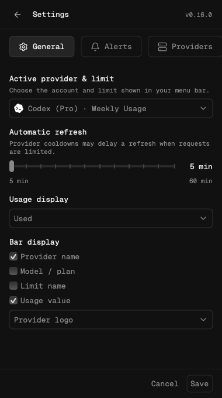
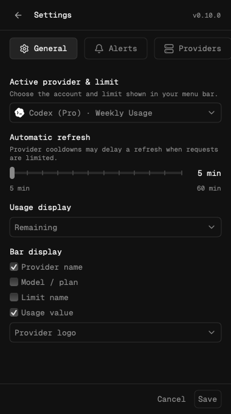

# Refresh interval previews

These images show the native macOS General settings after General and Appearance
were combined. The first shows the default 5-minute refresh interval; the second
shows a 20-minute draft with the remaining-usage display and Bot icon selected.
Both show the slider's 5–60 minute range and the separate Alerts section.

The PNGs are copied unchanged from the `macos-panel-preview` artifact produced by
the successful [macOS CI job](https://github.com/gelzinn/ai-status/actions/runs/38422515729/job/115383401044)
for commit `325dd5d7074e6a15c235387581580552f2e85e52`. They use the production
SwiftUI/AppKit controls and Geist Mono with synthetic Codex and Claude data.
No local app, build, test or rendering was run, and no live provider accounts or
reset credits were used.

| Default: 5 minutes | Draft: 20 minutes |
| --- | --- |
|  |  |

The Quickshell/Windows preview helper now supports the unified General layout
and `--refresh-only` captures for 5, 15 and 60 minutes. The images above are native
macOS captures from the existing CI artifact.
