# Native update progress previews

All **42 current app previews** appear directly in the tables below, alongside
**5 baseline screenshots**. They render production views with sample data and
never run a real update during capture. The fixture starts at v0.15.0 with
v0.16.0 available; the reopened Usage previews show v0.16.0.

Windows and macOS use the same short progress labels, including **Downloading…**,
with the percentage above a thin progress bar. Downloaded bytes appear on the left
and the remaining size on the right, such as **10.4 MB left**. The blue loader-circle
spinner stays beside the stage label for both known and unknown download sizes.
Unknown sizes use an indeterminate bar without a percentage or remaining-size
estimate. The active operation hides the action button.

All three platforms use a full-width outlined **Update now** button in the fixed
footer. Checking uses **Checking for updates…**, and external updater opening uses
**Opening updater…**, with a blue spinner and progress bar. Linux shows only this
feedback while running, and **Updater opened** afterward.

Every result uses two columns: the notice fills the left side, while an outlined
**Done** or **Retry** button on the right fits its text. Success shows a blue check
and **Up to date**, **Updater opened** or **Update complete**. Errors use the same
red (**#f5a3a3**) for the info icon and a short failure-and-cause label. Examples
include **Download failed: transfer interrupted** and **Update failed: Terminal
unavailable**. The original error stays available in tooltips or accessibility
descriptions. Manual alternatives keep
their command and links in the page, without duplicate footer instructions.

The page uses **Latest stable version**, one compact version row and **What's
new** with the new GitHub release's notes, matching the source used by the web
changelog. The existing release check supplies the notes without another network
request. Headings, lists and inline formatting make the changes readable before
updating. Long notes scroll while the action footer stays visible.

**Release notes**, **Update manually…** and **Installation guide** use full-width
outlined controls with consistent padding. Generic platform descriptions and
extra completion instructions have been removed. The optional manual command
stays collapsed until requested. Missing notes keep the GitHub link available;
notes from another version and already-installed releases are hidden. The sample
notes in these previews are fixtures, not a published v0.16.0 release.

## Before

| Step | Windows | macOS | Linux / Omarchy |
| --- | --- | --- | --- |
| Previous update notice | 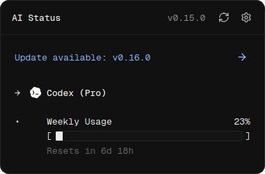 | — | — |
| Previous update page | 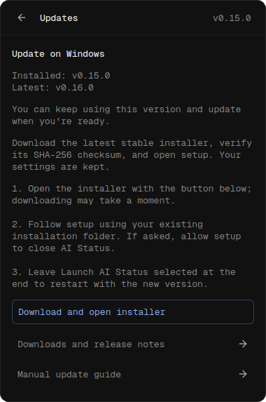 | 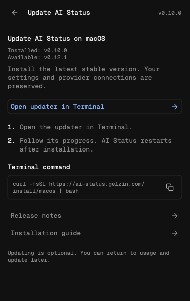 | 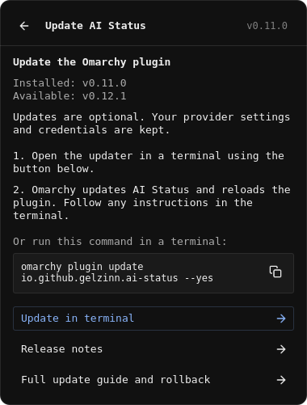 |
| Previous download feedback | 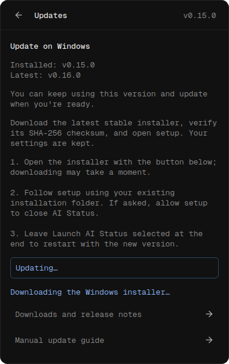 | Progress continued in Terminal | Progress continued in Terminal |

## Every update step

| Step | Windows | macOS | Linux / Omarchy |
| --- | --- | --- | --- |
| Update available |  | 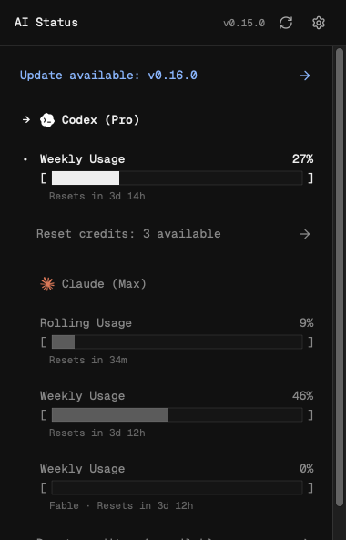 | 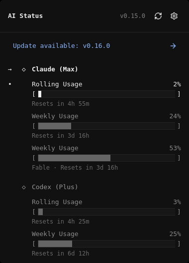 |
| Review the update | 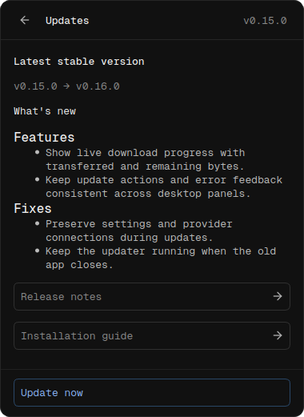 | 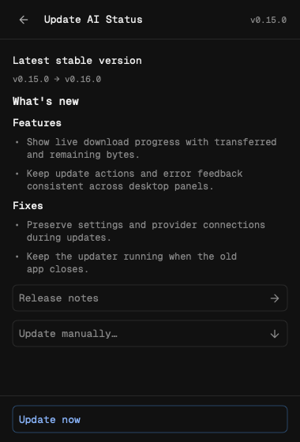 | 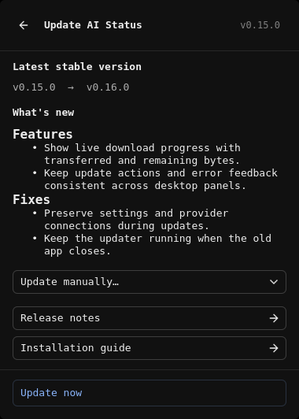 |
| Check the stable release | 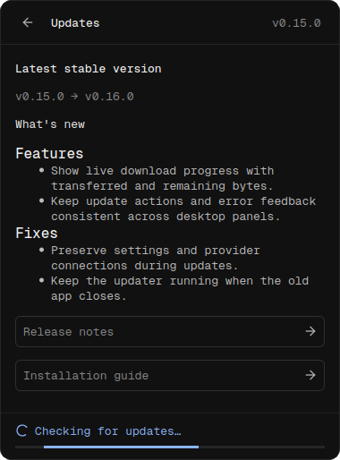 |  | 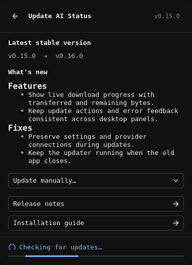 |
| Check the published checksum | 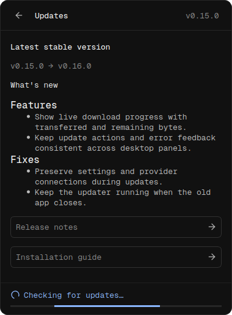 | Included in the release check | Continues in Terminal |
| Download without a known size | 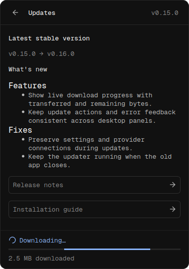 | 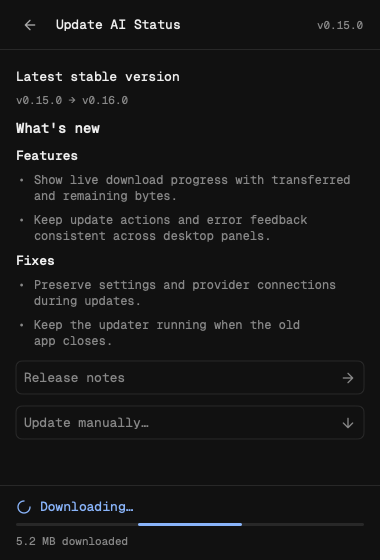 | Continues in Terminal |
| Download with a known size | 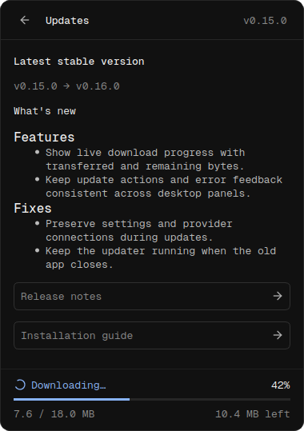 | 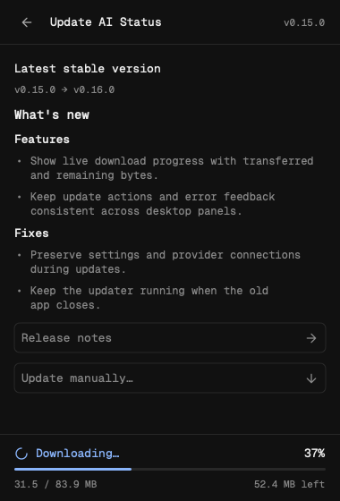 | Continues in Terminal |
| Verify the downloaded file | 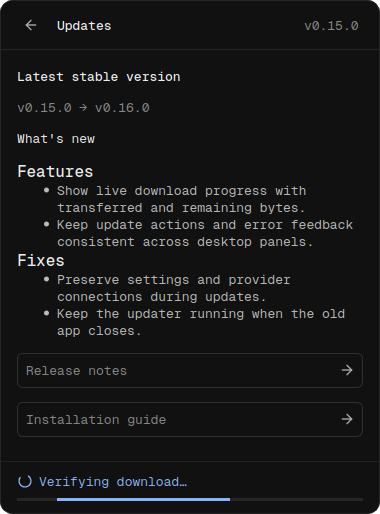 | 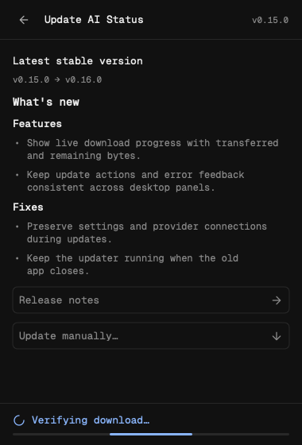 | Continues in Terminal |
| Open the external updater | 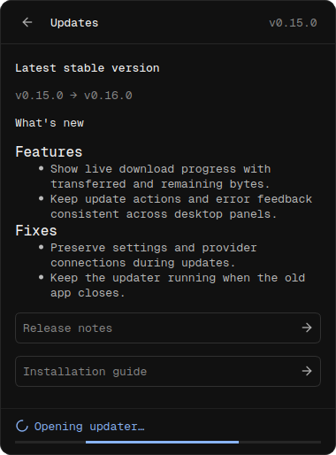 | Installation stays inside the app | 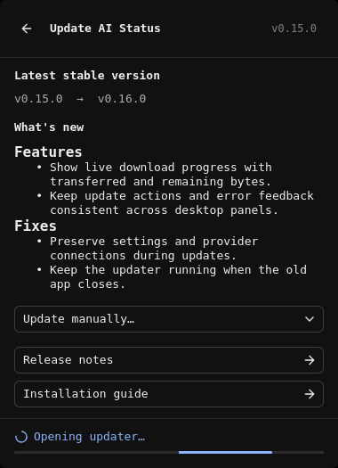 |
| External updater opened | 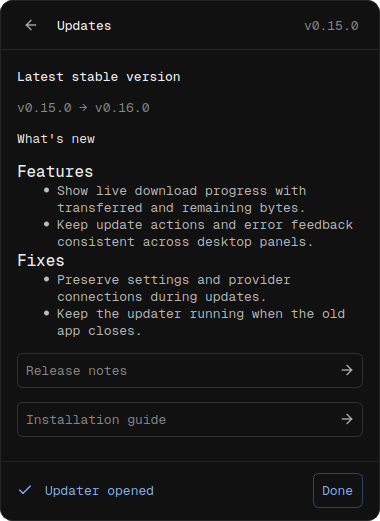 | Installation stays inside the app | 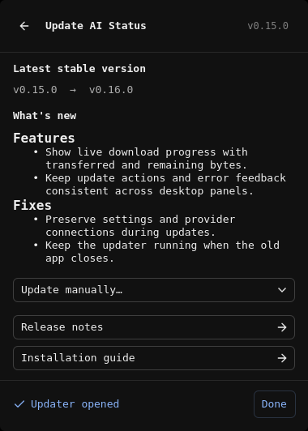 |
| Install the update | Finish in the Setup wizard | 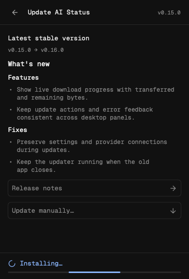 | Continues in Terminal |
| Restart the app or shell | Leave Launch AI Status selected in Setup | 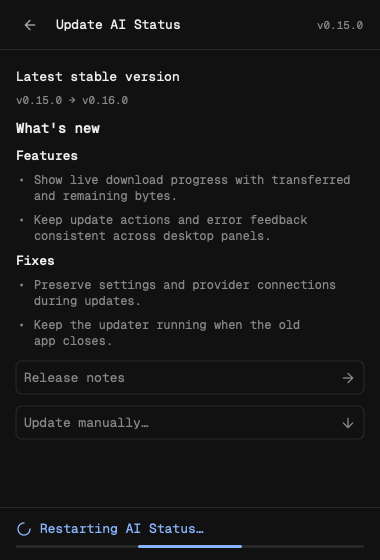 | Omarchy restarts the shell after a successful update |
| Completion feedback | Setup finishes installation | 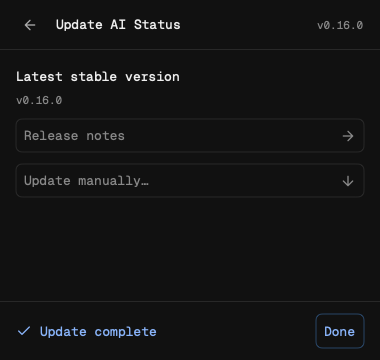 | Terminal finishes installation |
| Usage after reopening (v0.16.0) | 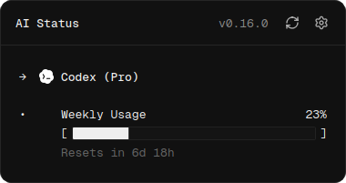 | 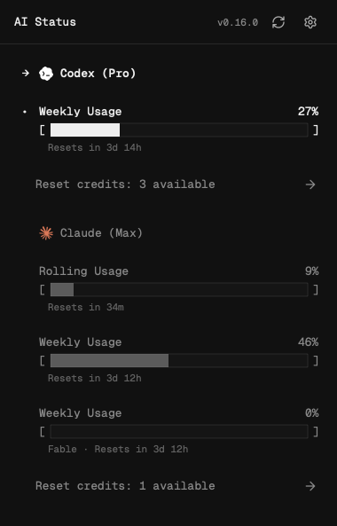 | 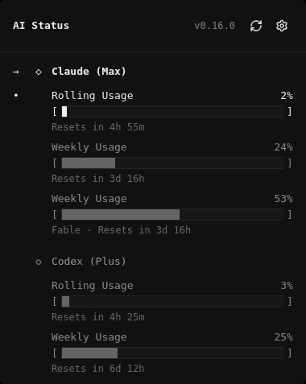 |

Windows completes installation in its Setup wizard. Linux completes download and
installation in Terminal. Those cells name the external window used for that
stage. The macOS completion preview renders the final CLI result in a fixture;
during a real update the old app closes at the restart stage, and the new app
opens on Usage, shown in the last row with sample v0.16.0.

## Other states and update paths

| Step | Windows | macOS | Linux / Omarchy |
| --- | --- | --- | --- |
| Optional manual command | See Installation guide | 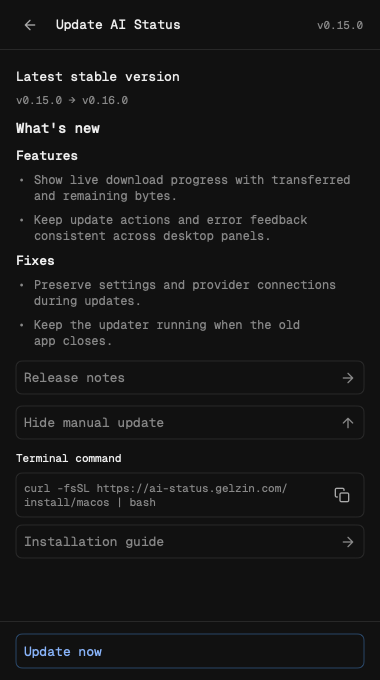 | 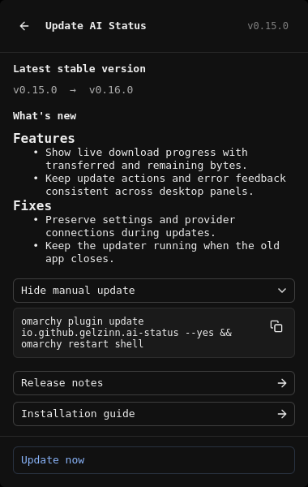 |
| Already up to date | 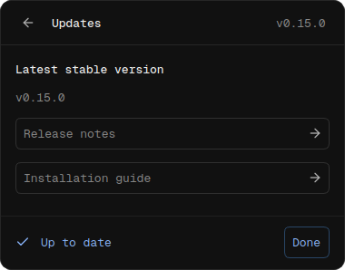 | 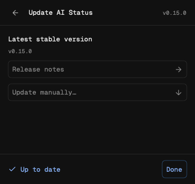 | 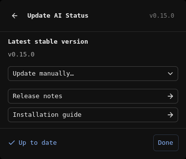 |
| Download or terminal error | 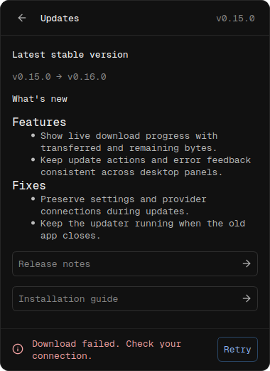 | 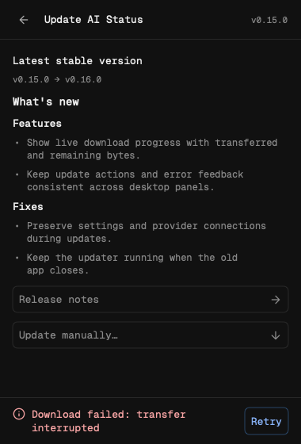 | 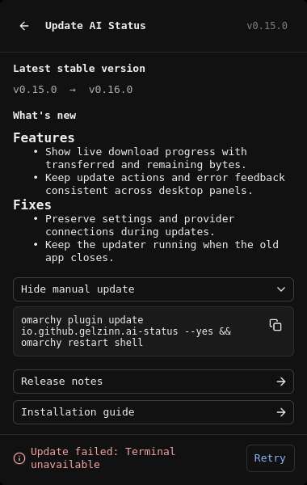 |
| Runtime unavailable | See the error feedback above | 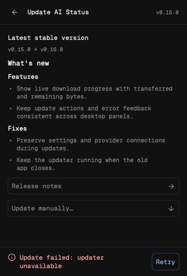 | See the error feedback above |
| Retry the update | 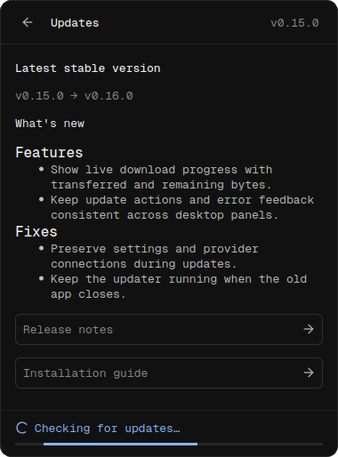 | 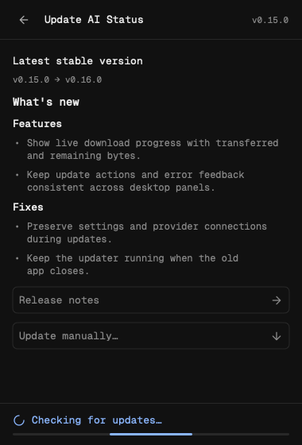 | 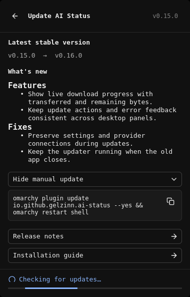 |
| Manual installation fallback | See Installation guide | 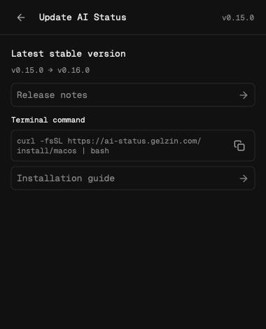 | See Installation guide |
| SwiftBar update page | — | 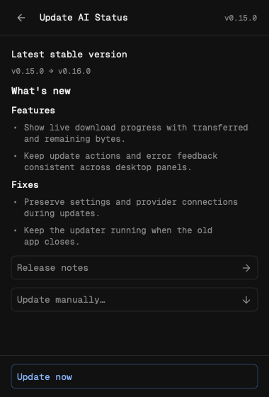 | — |
| Open Terminal for SwiftBar | — | 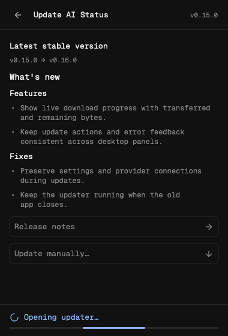 | — |
| SwiftBar updater opened | — | 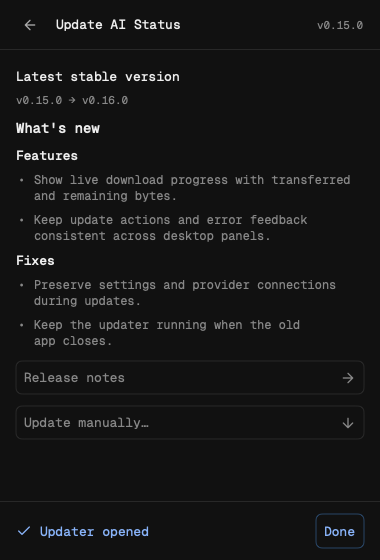 | — |

The fixed footer remains visible while content scrolls. Progress survives
navigation and reopening the panel. **Done** returns to Usage after Windows/Linux
handoff; errors offer retry. SwiftBar keeps its Terminal update path.

## Capture sources and reproduction

- Windows: production Qt widgets rendered offscreen on Linux with PySide6 6.12,
  bundled fonts and artwork. Source: commit `34eec1f`. Baselines render the old
  widgets and guide from `38df1df` with the same sample versions.
- Linux: production QML rendered offscreen with Qt Quick's software renderer and
  the test daemon/Omarchy theme (dark surface, blue accent, 6px corners). Source:
  commit `34eec1f`; this does not capture a running Omarchy desktop.
- macOS: unmodified `update-*.png` files from the `macos-panel-preview` artifact
  for commit `34eec1f` in the
  [native macOS CI run](https://github.com/gelzinn/ai-status/actions/runs/38320781770/job/115048142321).
- The Linux and macOS baselines are the existing tracked
  [Linux guide](../updates-linux-guide.png) and
  [native macOS guide](../updates-macos-guide.png), copied without alteration.

From the repository root, with the desktop test dependencies installed:

```bash
QT_QPA_PLATFORM=offscreen PYTHONPATH=packages/lib/src \
  python3 packages/lib/tests/render_update_previews.py --output docs/screenshots/update-progress
QT_QPA_PLATFORM=offscreen PYTHONPATH=packages/lib/src \
  python3 packages/lib/tests/render_update_previews.py --output docs/screenshots/update-progress/before --before-ref 38df1df
QT_QPA_PLATFORM=offscreen QT_QUICK_BACKEND=software \
  python3 packages/lib/tests/render_update_progress_qml.py --output docs/screenshots/update-progress
```

On macOS, build the app as described in
[macOS development](../../development/macos.md), then run the binary with
`--smoke --preview-directory /tmp/ai-status-update-previews`. Copy its
`update-*.png` files here with the `macos-` prefix. The local CLI fixtures validate
live progress, split lines, large stdout/stderr output, final output without a
newline, error and retry; they never execute an installer.

